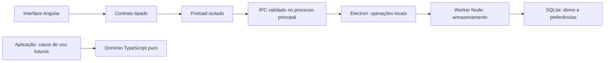

# Arquitetura

O FinDesk é um aplicativo desktop local com interface Angular. A casca concretiza as responsabilidades estabelecidas no mestre, sem introduzir servidor de aplicação, serviços externos ou uma arquitetura distribuída.

## Código existente

Por solicitação de Gabriel em 29/10/2026, toda a aplicação e suas ferramentas foram agrupadas em `FinDesk-Project/`. `docs/`, anotações e contexto permanecem na raiz; `.git` também, preservando um único repositório. As relações internas entre Angular, Electron, contratos, scripts e assets não mudaram. Execute npm a partir de `FinDesk-Project/`.

| Local                                             | Responsabilidade                                                                                          |
| ------------------------------------------------- | --------------------------------------------------------------------------------------------------------- |
| `FinDesk-Project/src/app/`                        | Composição da janela, rotas e páginas provisórias                                                         |
| `FinDesk-Project/src/app/core/runtime.service.ts` | Estado de consulta da versão, erro e ambiente de prévia; sem regras financeiras                           |
| `FinDesk-Project/src/app/features/`               | Páginas da casca e propostas de identidade                                                                |
| `FinDesk-Project/shared/`                         | Identidade textual centralizada e contrato da ponte, sem dependência de Angular/Electron                  |
| `FinDesk-Project/desktop/main.ts`                 | Janela nativa, protocolo local, política de segurança e operação IPC                                      |
| `FinDesk-Project/desktop/preload.ts`              | Uma operação explícita exposta via `contextBridge`, com contrato tipado                                   |
| `FinDesk-Project/desktop/security.ts`             | Validação de origens, limites do protocolo de arquivos e CSP                                              |
| `FinDesk-Project/scripts/dev.mjs`                 | Compilação inicial do Electron, servidor Angular local e encerramento dos processos iniciados pelo script |
| `FinDesk-Project/tests/`                          | Segurança das fronteiras e teste real de navegação no Electron                                            |

A F01b acrescenta `FinDesk-Project/domain/` com dinheiro, datas civis, contratos de fatos e validação de vínculos/saldos/subtotais. É TypeScript puro, sem Angular, Electron, arquivos ou rede. `FinDesk-Project/fixtures/financas/demo.ts` contém somente fatos inventados e relógio fixo, com fábricas independentes para as variantes. Não é seed, banco ou fonte pessoal.

`tsconfig.domain.json` verifica/compila domínio e fixtures para testes Node em `out/`. F01c.2 acrescenta `desktop/storage/`: serviço no principal → worker Node → SQLite da demonstração e preferências. A interface ainda não renderiza fatos financeiros; a ponte ganhou operações específicas de armazenamento. Angular não executa SQL nem recebe credenciais. Nenhuma dependência externa foi adicionada.

## Estado e gestos da navegação

`FinDesk-Project/src/app/layout/` concentra o estado de recolhimento e os gestos de encaixe da navegação. D67 inicia pelo fundo do painel, protegendo links, botões e rolagem; captura de ponteiro após limiar de 6 px e cancelamento ficam no renderer. Menu do PrimeNG permanece por clique direito no fundo ou Enter/espaço com foco no painel, sem alça visível. Classes temporárias no elemento raiz mantêm cursor de movimento somente durante arraste efetivo de navbar/cards e são removidas ao terminar/cancelar/destruir. Sem novas operações IPC, dependências ou armazenamento. A barra pode ocupar qualquer borda; a área restante rola sem passar por baixo dela. Redimensionamento manual continua retirado conforme D20.

## Fluxo de inicialização

`npm start` compila TypeScript do desktop e Angular e abre o build de produção. O processo principal registra o protocolo `findesk://app`, carrega `index.html` local e só mostra a janela quando pronta. Rotas usam hash; recarregar Investimentos não depende de um servidor de fallback. Não há consulta financeira ou sincronização nesta versão.

`npm run dev` compila o desktop e inicia Angular em `127.0.0.1:4200`, acessível somente por loopback. O modo de desenvolvimento é explícito (`--dev`) e fica indisponível em app empacotado. A interface recarrega após mudanças; alterações no processo principal/preload exigem reiniciar o comando. O servidor Angular serve apenas ao desenvolvimento, não é um backend HTTP de aplicação.

`npm run dev:web` permite avaliar a interface no navegador sem Electron. O serviço de versão reconhece esse ambiente e não inventa uma conexão com a ponte. Isso não constitui uma versão web distribuível ou acesso pelo iPhone.

## Fronteira de segurança

- `nodeIntegration: false`, `contextIsolation: true`, `sandbox: true`, `webSecurity: true` e `webviewTag: false`.
- Ponte com getRuntimeInfo e grupo restrito storage (status, leitura demo, preferências e restauração explícita). Renderer não recebe ipcRenderer, SQL, caminhos ou execução genérica. Gravação de fatos completos é somente interna.
- Principal verifica remetente, frame principal, URL exata e quantidade/formato dos argumentos. Preferências rejeitam extras; restauração exige token literal. Worker valida a mensagem novamente. Preload importa contratos apenas como tipos, pois o sandbox não carrega módulos locais.
- Protocolo restrito ao diretório do build, com validação de host, credenciais, decodificação e travessia de diretórios.
- CSP de produção sem scripts inline/eval, frames, formulários ou conexões externas. Estilos inline são permitidos para a renderização suportada de Angular/PrimeNG; isso não libera scripts inline.
- Novas janelas, navegação externa, downloads e permissões são bloqueados. Links externos não são abertos automaticamente.
- Sem serviço em segundo plano após fechar a última janela no Windows. Sem autoatualização, tray, autenticação, conexões bancárias ou telemetria nesta entrega.

O isolamento não dispensa validação das futuras operações de dados. Fuses, assinatura, instalador e política de distribuição serão tratados no escopo de empacotamento, sem alegar que já foram validados.

## Evolução local

D74–D76: `CardLayoutAction` apresenta a ação de restauração na linha de submenus de FinancePage. CardLayoutState compartilha somente os estados transitórios de presença/foco/confirmação; CardBoard mantém gestos e conteúdo, limpa esses estados ao sair e continua usando as mesmas operações de persistência. `assistedCardHeight` calcula o encaixe curto a partir dos vizinhos da linha inicial, com entrada de 8 px e saída de 12 px; guia é somente apresentação. Topbar sai do fluxo visual mantendo sua posição e eventos restritos à ação Sobre. `dockTarget` conserva a escolha da borda mais próxima com faixa ampliada para 128 px. Sem alteração de esquema/IPC ou dependência.

Quando o resultado compacto exigir limitar `scrollTop` ao finalizar, a prévia compensa esse limite nas caixas e no destino. Assim, retirar a altura temporária não muda a posição de tela já mostrada para a soltura; o card flutuante continua seguindo o ponteiro.

Correção de arraste entre linhas: durante movimento, `CardBoard` mantém uma altura de apresentação que nunca diminui no gesto, evitando que o navegador limite `scrollTop` ao mudar a prévia. Destinos usam linhas estáveis de origem, com escolha vertical antes da horizontal. Inserção pode liberar `rowStarts` mesmo sem alterar a ordem dos IDs. Um agendamento de frames coordena ponteiro, rolagem manual e automática, com velocidade por tempo; listeners da rolagem têm AbortController por gesto. Ao soltar, não rolar novamente; concluir/cancelar remove listeners, frame, altura reservada, cursor e camada superior. Não há mudança de contrato de armazenamento.

D73: `resizeCard` recebe a largura de apresentação e distingue crescimento horizontal de redução/ajuste vertical. Registra limites das linhas existentes em `rowStarts` opcional no layout v3; o resolvedor só comprime dentro desses limites e mantém cards de largura completa em linha própria. Redução ajusta o alinhamento no espaço liberado para não deslocar os vizinhos. Reordenação/troca libera os limites para reorganização normal. Edição na janela estreita preserva a estrutura ampla, em vez de salvar quebras responsivas.

D72 amplia o contrato de layout para v3 com preferência horizontal normalizada no espaço livre da linha; v1/v2 são lidas sem escrita e preservadas ao salvar o novo namespace. `previewCardDrop` só usa posicionamento horizontal quando o card permanece na própria linha e cabe entre os vizinhos; outras linhas/colisões mantêm troca/inserção existentes. O resolvedor limita alinhamentos para não sobrepor cards e ignora o deslocamento visual quando não há espaço, preservando a preferência. Ao soltar, aplicar o modelo final antes de retirar a camada superior e sincronizar as caixas sem transição transitória; não recalcular um ponto já processado. Salvamento automático usa anúncio acessível sem espaço no fluxo visual. `scrollbar-gutter: stable` mantém a largura do workspace ao aparecer/desaparecer rolagem.

D71 acrescenta `previewCardDrop`: sobreposição troca somente os dois IDs; fora do retângulo do destino usa inserção. O resultado completo da prévia é salvo ao soltar, sem reduzir uma troca à operação de inserção. A promoção à camada superior prepara coordenadas/dimensões e classe de movimento antes da exposição; o card ativo não tem transições, evitando estado transitório no centro da tela. Estilos anteriores são restaurados ao encerrar.

D70 acrescenta `cardInsertionIndex` puro para escolher antes/depois e extremidades de linhas a partir das caixas iniciais, com origem estável e sem oscilar com o deslocamento dos vizinhos. CardBoard mantém a ordem do DOM durante a prévia e leva a mesma instância arrastada à camada superior via Popover API manual, com coordenadas fixas sem limite do conteúdo. A prévia altera só apresentação/ordem em memória, incluindo o espaço de destino; gravação continua apenas no fim válido. Soltar fora/Escape limpa a camada superior e restaura o layout. Persistência v2 e dimensões preferidas não mudam. D69 destaca navbar e destino em verde durante o gesto.

F03a: `application/card-layout.ts` mantém contrato/transformações puras e resolve linhas alinhadas sem coordenadas livres persistidas. Dimensões contínuas e prioridade do último redimensionado permitem comprimir vizinhos até o mínimo de 280 px antes de mudar de linha e restaurar suas larguras preferidas. DashboardCard projeta conteúdo e protege controles interativos; CardBoard agrupa movimentos por requestAnimationFrame, captura o ponteiro após o limiar de 6 px, coordena teclado/cancelamento e foco temporário por duplo clique. As caixas calculadas são posicionadas sem transição de tamanho para acompanhar o mouse. CardLayoutState serializa gravações somente ao terminar ajustes e informa falhas sem fingir persistência. Ler/salvar/restaurar usa três operações restritas, validadas em principal/worker. Layout v2 aceita leitura legada v1 sem reescrever ao abrir. Sem nova biblioteca, acesso arbitrário ao banco ou alteração dos fatos financeiros.

SQLite foi confirmado na F01a; [ADR 0002](adr/0002-sqlite-local-proposto.md) registra comparação, prova e limites. Na F01c.1, node:sqlite foi avaliado no Electron real em worker Node dedicado, com arquivos/perfil temporários e sem renderer. Não é worker privilegiado da interface; a segurança da janela não mudou. D25 confirma essa arquitetura para a próxima implementação; não há novo serviço persistente integrado ao aplicativo ainda.

D26/D27 confirmam LocalAppData e restauração demo preservando preferências/layout. F01c.2 implementa esquema agregado v1, migrações transacionais, seed idempotente, worker e IPC restrito. Inicialização do banco é assíncrona em relação à abertura da janela; falha mantém a casca acessível e retorna erro sanitizado pela ponte. Antes de sair, o principal fecha o serviço e encerra o worker.

Testes usam somente storage sob perfis temporários findesk-*, validados no modo de teste; perfil inadequado falha sem cair no LocalAppData real. Execução normal usa LOCALAPPDATA e falha se indisponível, sem fallback para o repositório. F01c.3 apresenta estado/restauração em Configurações por serviço local de apresentação usando a ponte existente; nenhum SQL ou caminho chega ao componente. Distribuição/ASAR, recuperação de corrupção e múltiplas instâncias não foram validados ou redefinidos. Não confundir Node de desenvolvimento com o embarcado.

Domínio e casos de uso devem permanecer independentes do transporte desktop sempre que possível. Essa separação prepara a evolução sem implementar antecipadamente uma plataforma móvel.

F02b.3: ajustes por conta usam a mesma fila do FinancePreferencesStore; o processo privilegiado valida o contrato v3 e vínculos da conta/cartão. Configurações lê contas pelo contexto existente. Catálogos reativos aplicam regras salvas imediatamente; a preferência de modo padrão mantém sua captura inicial. `monthlyCivilDate` aplica mês curto sem fuso/dias úteis; `configuredSalaryPeriods` deriva períodos com prioridade das datas confirmadas e corte de ativação. Navegação futura amplia o catálogo conforme a consulta, sem gravar fatos ou antecipar o motor de previsões F12.

F02b.2: `FinancePreferencesStore` compartilha leitura e fila de atualizações do renderer entre o contexto e Configurações. Cada operação mescla seus campos sobre o último valor confirmado, preservando os demais; falhas não substituem o estado salvo. Captura do padrão inicial mantém a aplicação na próxima abertura mesmo quando Configurações é visitada primeiro. Ponte, esquema e validações privilegiadas permanecem iguais.

F02a: `application/finance-context.ts` contém apresentação pura do saldo/intervalo e formatação exata; reutiliza o domínio sem acessar Angular, Electron ou SQLite. FinanceContext mantém estado de tela por execução e lê/grava pela ponte existente. Rotas filhas próprias preservam o cabeçalho entre os cinco submenus; a página provisória de Investimentos permanece independente. Preferências v2 têm migração local transacional; não há transporte genérico adicional.

D37/D38: `application/finance-periods.ts` monta intervalos a partir das previsões/fechamentos explícitos; `adjacentCivilDate` é aritmética gregoriana sem fuso ou dia útil. O contexto mantém modo e intervalo temporários, navega só no catálogo salvo e aplica retorno ao calendário por conta incompatível. `PeriodControl` apresenta botões/expansão e aciona o contexto; não calcula consumo nem grava preferência padrão. API, esquema e fatos não foram ampliados por essa revisão.
