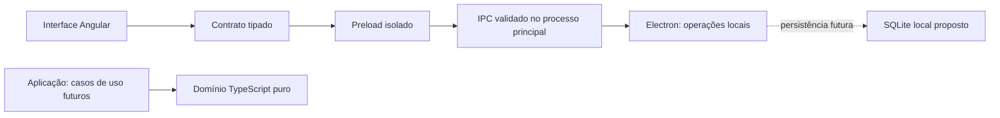

# Arquitetura

O FinDesk é um aplicativo desktop local com interface Angular. A casca concretiza as responsabilidades estabelecidas no mestre, sem introduzir servidor de aplicação, serviços externos ou uma arquitetura distribuída.

## Código existente

Por solicitação de Gabriel em 29/10/2026, toda a aplicação e suas ferramentas foram agrupadas em `FinDesk-Project/`. `docs/`, anotações e contexto permanecem na raiz; `.git` também, preservando um único repositório. As relações internas entre Angular, Electron, contratos, scripts e assets não mudaram. Execute npm a partir de `FinDesk-Project/`.

| Local                                             | Responsabilidade                                                                                          |
| ------------------------------------------------- | --------------------------------------------------------------------------------------------------------- |
| `FinDesk-Project/src/app/`                        | Composição da janela, rotas e páginas provisórias                                                         |
| `FinDesk-Project/src/app/core/runtime.service.ts` | Estado de consulta da versão, erro e ambiente de prévia; sem regras financeiras                           |
| `FinDesk-Project/src/app/features/`               | Páginas da casca e propostas de identidade                                                                |
| `FinDesk-Project/shared/`                         | Identidade textual centralizada e contrato da ponte, sem dependência de Angular/Electron                  |
| `FinDesk-Project/desktop/main.ts`                 | Janela nativa, protocolo local, política de segurança e operação IPC                                      |
| `FinDesk-Project/desktop/preload.ts`              | Uma operação explícita exposta via `contextBridge`, com contrato tipado                                   |
| `FinDesk-Project/desktop/security.ts`             | Validação de origens, limites do protocolo de arquivos e CSP                                              |
| `FinDesk-Project/scripts/dev.mjs`                 | Compilação inicial do Electron, servidor Angular local e encerramento dos processos iniciados pelo script |
| `FinDesk-Project/tests/`                          | Segurança das fronteiras e teste real de navegação no Electron                                            |

As camadas de domínio, aplicação financeira e infraestrutura de dados ainda não têm implementação. Não foram criadas pastas vazias nem interfaces genéricas para antecipar funções desconhecidas. Ao introduzir regras, elas entram no domínio TypeScript puro; casos de uso coordenam regras e portas necessárias; persistência fica na infraestrutura privilegiada. Angular não executa SQL nem recebe credenciais.

## Estado e gestos da navegação

`FinDesk-Project/src/app/layout/` concentra o estado de recolhimento e os gestos de encaixe da navegação. Captura de ponteiro e cancelamento são tratados no renderer; não há novas operações IPC, dependências ou armazenamento. A barra pode ocupar qualquer borda; a área restante rola sem passar por baixo dela. A alça usa o Menu do PrimeNG como alternativa acessível ao arraste. O redimensionamento manual foi retirado conforme D20.

## Fluxo de inicialização

`npm start` compila TypeScript do desktop e Angular e abre o build de produção. O processo principal registra o protocolo `findesk://app`, carrega `index.html` local e só mostra a janela quando pronta. Rotas usam hash; recarregar Investimentos não depende de um servidor de fallback. Não há consulta financeira ou sincronização nesta versão.

`npm run dev` compila o desktop e inicia Angular em `127.0.0.1:4200`, acessível somente por loopback. O modo de desenvolvimento é explícito (`--dev`) e fica indisponível em app empacotado. A interface recarrega após mudanças; alterações no processo principal/preload exigem reiniciar o comando. O servidor Angular serve apenas ao desenvolvimento, não é um backend HTTP de aplicação.

`npm run dev:web` permite avaliar a interface no navegador sem Electron. O serviço de versão reconhece esse ambiente e não inventa uma conexão com a ponte. Isso não constitui uma versão web distribuível ou acesso pelo iPhone.

## Fronteira de segurança

- `nodeIntegration: false`, `contextIsolation: true`, `sandbox: true`, `webSecurity: true` e `webviewTag: false`.
- Ponte com apenas `getRuntimeInfo()`. O renderer não recebe `ipcRenderer`, nomes arbitrários de canais, caminhos locais ou funções de execução.
- Processo principal verifica remetente, frame principal, URL exata e ausência de argumentos antes de responder. O preload importa contratos apenas como tipos, pois seu sandbox não deve carregar módulos locais.
- Protocolo restrito ao diretório do build, com validação de host, credenciais, decodificação e travessia de diretórios.
- CSP de produção sem scripts inline/eval, frames, formulários ou conexões externas. Estilos inline são permitidos para a renderização suportada de Angular/PrimeNG; isso não libera scripts inline.
- Novas janelas, navegação externa, downloads e permissões são bloqueados. Links externos não são abertos automaticamente.
- Sem serviço em segundo plano após fechar a última janela no Windows. Sem autoatualização, tray, autenticação, conexões bancárias ou telemetria nesta entrega.

O isolamento não dispensa validação das futuras operações de dados. Fuses, assinatura, instalador e política de distribuição serão tratados no escopo de empacotamento, sem alegar que já foram validados.

## Evolução local

SQLite permanece proposto; [ADR 0002](adr/0002-sqlite-local-proposto.md) registra as condições para adotá-lo. Antes da persistência, discutir os comportamentos abertos, definir a separação de demonstração/dados futuros e migrations, e pesquisar o driver compatível com o Node embutido no Electron. Não confundir a versão Node de desenvolvimento com a versão embarcada.

Domínio e casos de uso devem permanecer independentes do transporte desktop sempre que possível. Essa separação prepara a evolução sem implementar antecipadamente uma plataforma móvel.
